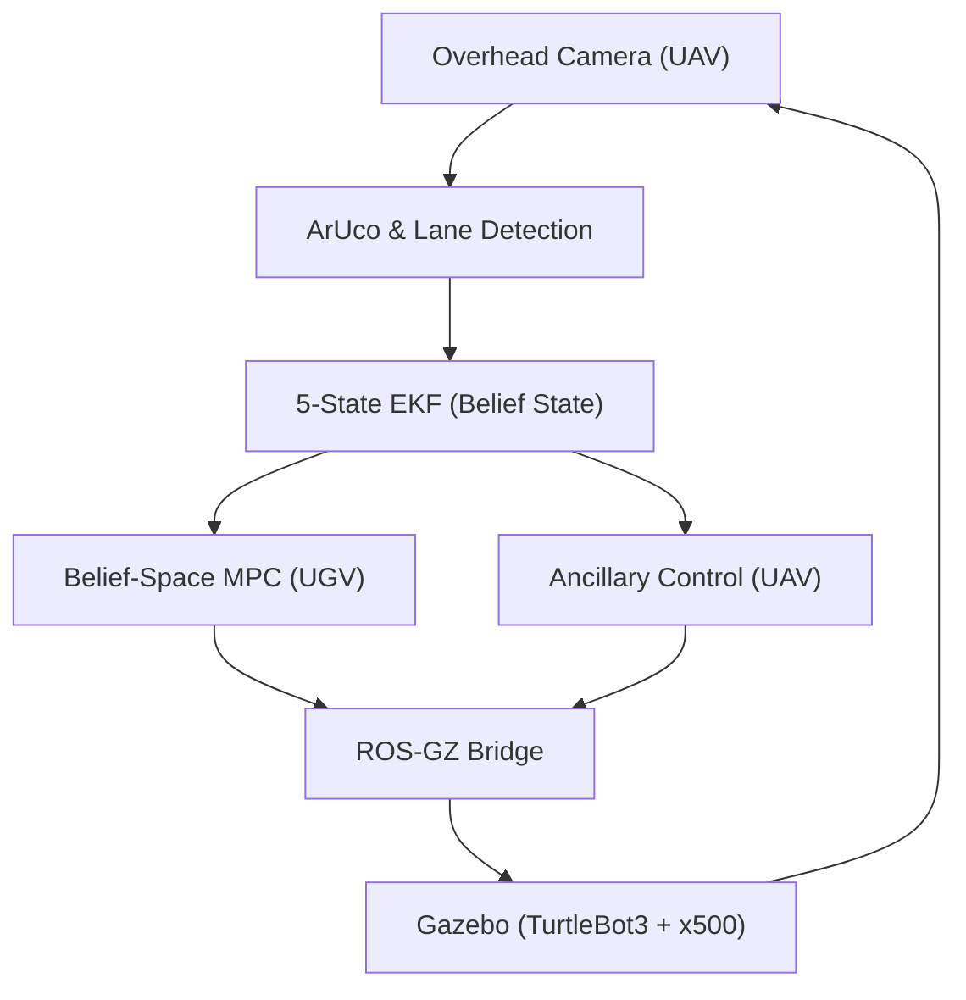

# 03: System Integration and Validation (ROS 2)

This folder contains the complete ROS 2 and Gazebo integration for the UAV-UGV tracking mission. This phase serves as the high-fidelity validation of the mathematical models from Phase 1 and the flight trajectories from Phase 2.

## System Architecture


## Key Implementation Details
*   **Perception**: OpenCV-based lane centerline extraction and ArUco ID 55 tracking.
*   **Estimation**: 5-state Extended Kalman Filter (EKF) with dynamic measurement noise ($R_k$).
*   **Control**: 
    *   **Belief-Space MPC**: UGV path following with observability constraints.
    *   **Ancillary Tube-MPC**: UAV altitude and pose adaptation for FoV maintenance.

## Codebase Overview
The core logic is implemented in the following nodes within `src/ugv_uav_control/ugv_uav_control/`:
*   **`belief_mpc_node.py`**: Implements the UGV's Nonlinear MPC. It incorporates the EKF covariance trace into the cost function to moderate ground velocity based on observability quality.
*   **`middle_path_follower.py`**: Handles the vision pipeline. It uses OpenCV to extract the lane centerline heatmap and transforms pixel coordinates to world-frame waypoints.
*   **`uav_ancillary_node.py`**: Manages the UAV's pose and altitude adaptation. It triggers altitude increases based on UGV curvature to expand the Field-of-View.
*   **`ekf_node.py`**: A 5-state Extended Kalman Filter that fuses ArUco detections with odometry, providing the real-time "belief state" ($\Sigma$) to the controllers.
*   **`middle_path_follower.launch.py`**: The primary entry point. It launches the Gazebo simulation, spawns the UGV and UAV, and sets up all core control, EKF, and vision nodes.

## Comparative Evaluation Metrics
These figures summarize the performance comparison between the continuous baseline (C1), the standard reactive event-triggered Tube-MPC (C2), and the proposed Belief-MPC (C3) under nominal conditions:

| Metric | C1 (Continuous MPC) | C2 (Reactive Tube-MPC) | C3 (Proposed Belief-MPC) |
| :--- | :--- | :--- | :--- |
| **Number of Replans** | 1,102 | 105 | **99 (-91.0%)** |
| **Mean Tracking Offset (m)** | 0.6395 m | 0.4811 m | 0.6888 m |
| **Max Tracking Offset (m)** | 1.0458 m | 0.5774 m | 1.1232 m |
| **Control Jerk** | 0.0195 | 0.0151 | 0.0286 |
| **Mean Covariance Trace $tr(\Sigma)$** | 0.0067 | 0.0065 | 0.0065 |
| **ArUco Visibility (%)** | 100.0% | 100.0% | 100.0% |

## Scientific Inferences
*   **Significant Compute Savings**: Both event-triggered formulations (C2 and C3) reduce the optimization load by over 90% compared to Continuous MPC (C1), saving onboard compute while maintaining stable tracking.
*   **Uncertainty-Aware Adaptive Envelope**: Under nominal conditions where uncertainty is low, the proposed Belief-MPC (C3) expands the allowed tracking bounds (up to 1.12m), saving control actions, while contracting the bounds to safeguard the system when uncertainty rises.
*   **Decoupled Local Tracking**: The local waypoint generation in the UGV base frame ensures that UGV path tracking remains stable even in the event of EKF state drift.

## Prerequisites and Dependencies
Ensure your environment meets the following requirements before building:
*   **Operating System**: Linux (Ubuntu 22.04 or 24.04 recommended)
*   **ROS 2 Distribution**: Humble or Iron
*   **Simulator**: Gazebo Harmonic
*   **Python Dependencies**:
    ```bash
    pip install numpy scipy opencv-python pandas matplotlib
    ```

## Build Instructions
Standard ROS 2 workspace initialization:
```bash
# From the 03_System_Integration_ROS2 directory
rosdep install -i --from-path src --rosdistro $ROS_DISTRO -y
colcon build --symlink-install --packages-select ugv_uav_control
source install/setup.bash
```

## Execution and Verification
To launch the full tracking mission and verify the results:
```bash
# Launch the integrated mission
ros2 launch ugv_uav_control middle_path_follower.launch.py \
    duration:=60.0 \
    controller:=belief_mpc \
    use_ancillary:=true
```

The system automatically logs telemetry to the `results` directory in the workspace. Upon mission completion, a summary CSV is generated which can be used to verify the metrics reported in the Master README and the Final Project Report.

---
*Course: LCS 334 - Linear Control Systems*
