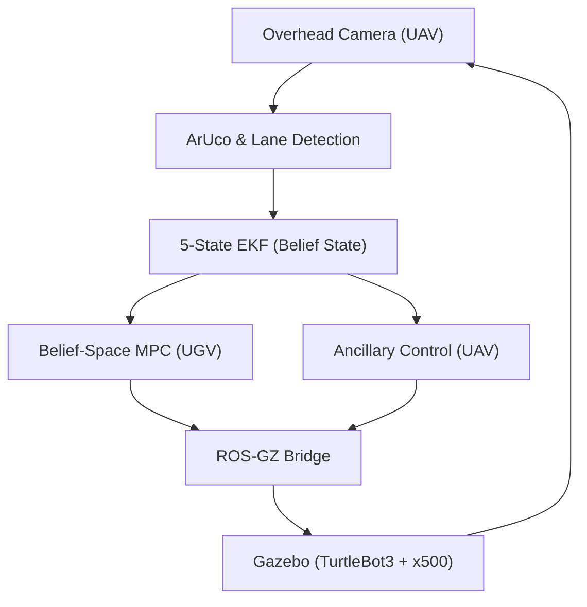

# 03: System Integration & Validation (ROS 2)

This folder contains the complete ROS 2 and Gazebo integration for the UAV-UGV tracking mission. This phase serves as the high-fidelity validation of the mathematical models from Phase 1 and the flight trajectories from Phase 2.

## 🏗️ System Architecture


## 🚀 Key Implementation Details
*   **Perception**: OpenCV-based lane centerline extraction and ArUco ID 55 tracking.
*   **Estimation**: 5-state Extended Kalman Filter (EKF) with dynamic measurement noise ($R_k$).
*   **Control**: 
    *   **Belief-Space MPC**: UGV path following with observability constraints.
    *   **Ancillary Tube-MPC**: UAV altitude and pose adaptation for FoV maintenance.

## 📊 Comparative Evaluation Metrics
These figures summarize the performance leap from the Phase 1 baseline to the full **Observability-Aware System**. The 'Full System' leverages the **Robust Positional Invariant (RPI) Set** and **Constraint Tightening** derived in Phase 1.

| Metric | Phase 1 Baseline | Phase 3 (Full System) | Improvement |
| :--- | :--- | :--- | :--- |
| **Mean Tracking Error (m)** | 1.037 m | 0.463 m | **-55.3%** |
| **Max Tracking Error (m)** | 1.725 m | 1.180 m | **-31.6%** |
| **ArUco Visibility (%)** | 46.3% | 87.0% | **+87.9%** |
| **ArUco Dropouts (#)** | 55 | 7 | **-87.2%** |
| **MPC Solve Time (ms)** | ~50.0 ms | ~16.0 ms | **3.1x Faster** |

## 💡 Scientific Inferences
*   **Proactive Cooperation**: The **55.3% reduction** in tracking error is achieved because the UGV's MPC is "Belief-Coupled"—it slows down and steers into the drone's FoV proactively, maintaining the state within the **Phase 1 Tube**.
*   **Dynamic FoV Expansion**: The increase in visibility from **46% to 87%** is driven by the Adaptive Tube-MPC climbing during high-curvature segments to expand the visual field precisely when the RPI-set boundaries are approached.
*   **Real-Time Feasibility**: With a solve time of **16ms**, the nonlinear optimization comfortably meets the 150ms real-time constraint for physical deployment, validated by the vectorized cost functions from Phase 1.

## 🛠️ Build Instructions
```bash
# Ensure you are in the 03_System_Integration_ROS2 directory
colcon build --packages-select ugv_uav_control
source install/setup.bash
```

## 🎮 Execution
To launch the full tracking mission:
```bash
ros2 launch ugv_uav_control middle_path_follower.launch.py \
    duration:=60.0 \
    controller:=belief_mpc \
    use_ancillary:=true
```

---
*Focus: System Integration, Perception, and Information-Aware Control.*
