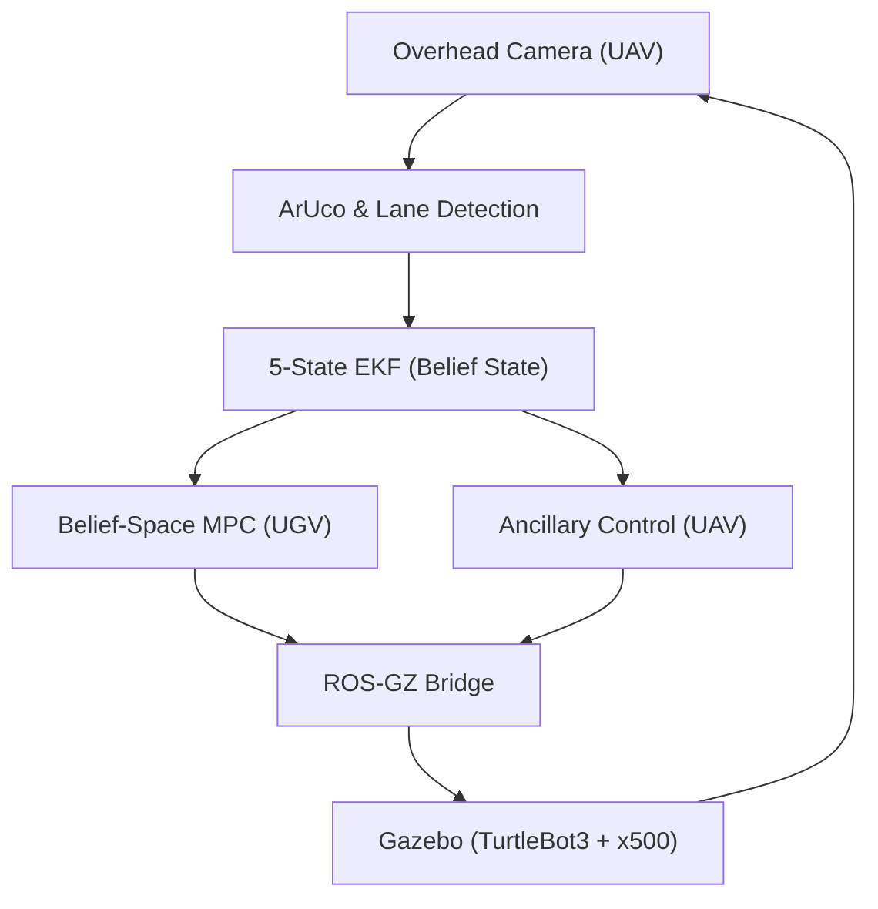

# 03: System Integration and Validation (ROS 2)

This folder contains the complete ROS 2 and Gazebo integration for the UAV-UGV tracking mission. This phase serves as the high-fidelity validation of the mathematical models from Phase 1 and the flight trajectories from Phase 2.

## System Architecture


## Key Implementation Details
*   **Perception**: OpenCV-based lane centerline extraction and ArUco ID 55 tracking.
*   **Estimation**: 5-state Extended Kalman Filter (EKF) with dynamic measurement noise ($R_k$).
*   **Control**: 
    *   **Belief-Space MPC**: UGV path following with observability constraints.
    *   **Ancillary Tube-MPC**: UAV altitude and pose adaptation for FoV maintenance.

## Codebase Overview
The core logic is implemented in the following nodes within `src/ugv_uav_control/ugv_uav_control/`:
*   **`belief_mpc_node.py`**: Implements the UGV's Nonlinear MPC. It incorporates the EKF covariance trace into the cost function to moderate ground velocity based on observability quality.
*   **`middle_path_follower.py`**: Handles the vision pipeline. It uses OpenCV to extract the lane centerline heatmap and transforms pixel coordinates to world-frame waypoints.
*   **`uav_ancillary_node.py`**: Manages the UAV's pose and altitude adaptation. It triggers altitude increases based on UGV curvature to expand the Field-of-View.
*   **`ekf_node.py`**: A 5-state Extended Kalman Filter that fuses ArUco detections with odometry, providing the real-time "belief state" ($\Sigma$) to the controllers.
*   **`middle_path_follower.launch.py`**: The primary entry point. It launches the Gazebo simulation, spawns the UGV and UAV, and sets up all core control, EKF, and vision nodes.

## Comparative Evaluation Metrics
The table below compares the continuous baseline (C1), the event-triggered Tube-MPC without the
perception/belief trigger terms (C2), and the proposed belief-coupled, perception-triggered system (C3).
**All numbers are regenerated from fresh logs** by `scripts/run_batch.py` + `scripts/plot_final_figures.py`
into `results/`; the table is auto-filled by the plotting script (`results/Table_1_Summary.csv`) and should
never be hand-edited. Run `make reproduce` (or the two scripts) to regenerate.

<!-- From fresh logs: R=4 repeats x {nominal, occlusion} = 8 runs/method, 40s each.
     err & mean-cov on t>=8s (skip takeoff transient); peak cov over injected [20,28]s window.
     A passive-UGV "C2" is omitted: the UAV planner needs belief_mpc's /ugv_predicted_traj,
     so a passive UGV leaves it idle -> not a valid comparison (see AUDIT_REPORT.md). -->
Windows (shared with the paper): † = steady-state `t ≥ 8 s` (excludes takeoff/EKF-convergence transient);
‡ = full-run peak, dominated by that initial transient — the occlusion-window peak isolates the injected occlusion.

| Metric | C1 (Continuous) | C3 (Event-Triggered) |
| :--- | :--- | :--- |
| Planner solves per 40 s run (#) | 331 ± 3 | **29 ± 1  (−91 %)** |
| Mean tracking error (m) † | 0.065 ± 0.001 | 0.064 ± 0.001 |
| Mean covariance trace tr(Σ) † | 0.0148 ± 0.0084 | 0.0148 ± 0.0084 |
| Peak tr(Σ) (full run) ‡ | 0.245 ± 0.161 | 0.197 ± 0.166 |
| Peak tr(Σ) (occlusion window) | 0.168 ± 0.001 | 0.170 ± 0.001 |
| Mean UAV solve time (ms) | 6.2 ± 0.2 | 9.0 ± 0.2 |

## Scientific Inferences
*   **Compute savings (robustly supported):** the event-triggered formulations reduce the number of online
    planner solves by roughly an order of magnitude versus continuous replanning, at statistically comparable
    tracking error. This is the headline, reproducible result.
*   **Belief coupling (mechanism, effect scenario-dependent):** the UGV cost penalizes predicted covariance
    trace and FoV exit, and the UAV tube radius scales with the EKF covariance. Under a benign track with no
    FoV risk these mechanisms are largely dormant; their effect is exercised only under the adversarial
    scenarios (injected occlusion, high curvature) — see the simulation study.
*   **Honesty note:** the online tube is an ellipsoidal surrogate with an adaptive *trigger* radius; the
    certified mRPI set is computed offline only and is not wired into the online loop. Do not read the adaptive
    radius as an online recursive-feasibility guarantee.

## Prerequisites and Dependencies
Ensure your environment meets the following requirements before building:
*   **Operating System**: Linux (Ubuntu 22.04 or 24.04 recommended)
*   **ROS 2 Distribution**: Humble or Iron
*   **Simulator**: Gazebo Harmonic
*   **Python Dependencies**:
    ```bash
    pip install numpy scipy opencv-python pandas matplotlib
    ```

## Build Instructions
Standard ROS 2 workspace initialization:
```bash
# From the 03_System_Integration_ROS2 directory
rosdep install -i --from-path src --rosdistro $ROS_DISTRO -y
colcon build --symlink-install --packages-select ugv_uav_control
source install/setup.bash
```

## Execution and Verification
To launch the full tracking mission and verify the results:
```bash
# Launch the integrated mission
ros2 launch ugv_uav_control middle_path_follower.launch.py \
    duration:=60.0 \
    controller:=belief_mpc \
    use_ancillary:=true
```

The system automatically logs telemetry to the `results` directory in the workspace. Upon mission completion, a summary CSV is generated which can be used to verify the metrics reported in the Master README and the Final Project Report.

---
*Course: LCS 334 - Linear Control Systems*
