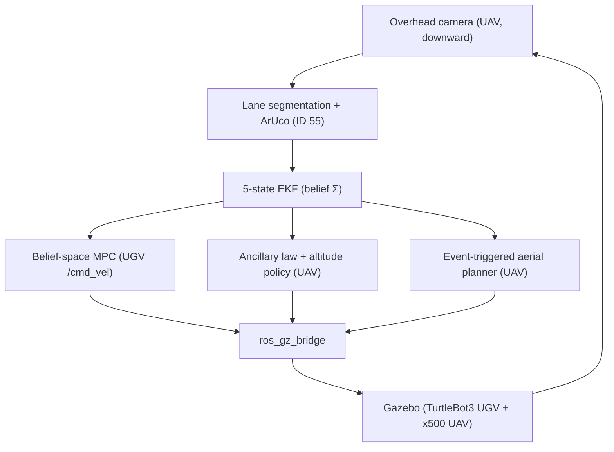

# ROS 2 Workspace — UAV–UGV Cooperative Tracking (SITL)

The ROS 2 / Gazebo software-in-the-loop implementation behind the paper. For the problem
statement, headline results, and the full reproduction guide, see the top-level
[`README.md`](../README.md) and `paper/ICC12.pdf`.

## System architecture



## Nodes (`src/ugv_uav_control/ugv_uav_control/`)

- **`middle_path_follower.py`** — vision pipeline: OpenCV lane-centerline extraction → world-frame
  waypoints, plus ArUco detection (ID 55, `DICT_6X6_250`) that feeds the EKF.
- **`ekf_node.py`** — 5-state Extended Kalman Filter fusing ArUco pose with odometry; publishes the
  belief covariance Σ used by the controllers.
- **`belief_mpc_node.py`** — the UGV's belief-space NMPC and its continuous `/cmd_vel` controller;
  penalizes predicted covariance trace and field-of-view exit to moderate ground speed by
  observability quality.
- **`uav_mpc_node.py`** — the aerial nominal planner, invoked by the perception-driven event trigger
  (the planner solves and CPU time reported in the co-design study, Table I).
- **`uav_ancillary_node.py`** — the UAV ancillary law and the perception-constrained altitude policy
  (fly as low as segmentation allows, climb into turns to preserve coverage).
- **`middle_path_follower.launch.py`** — entry point: brings up Gazebo, spawns both vehicles, and
  starts perception, EKF, and the controllers. Every experimental knob is a launch argument.

Alternative UGV controllers (`pure_pursuit_node`, `stanley_node`, `mpc_node`) are included for
comparison and selected with `controller:=`.

## Prerequisites

- Ubuntu 24.04, **ROS 2 Jazzy**, **Gazebo Harmonic** (`gz-sim` 8) with `ros_gz`.
- Python packages in `requirements.txt` (`pip install -r requirements.txt`).

## Build & run

```bash
rosdep install -i --from-path src --rosdistro jazzy -y   # first time only
colcon build --packages-select ugv_uav_control --symlink-install
source install/setup.bash

# Headless is required for reproducible closed-loop runs (see ../README.md):
GZ_HEADLESS=1 ros2 launch ugv_uav_control middle_path_follower.launch.py \
    duration:=60.0 controller:=belief_mpc use_ancillary:=true
```

Each run logs a per-step CSV and a `_summary.txt` into `results/`. The `Makefile` wraps the common
tasks (`make build`, `make figures`, `make codesign`).

## Note on the tube / mRPI

The online tube is an ellipsoidal surrogate with an adaptive, perception-gated *trigger* radius; the
certified mRPI set is computed offline as a design-time synthesis and is not wired into the online
loop. The adaptive radius should not be read as an online recursive-feasibility guarantee. This is
stated as scope in the paper.
